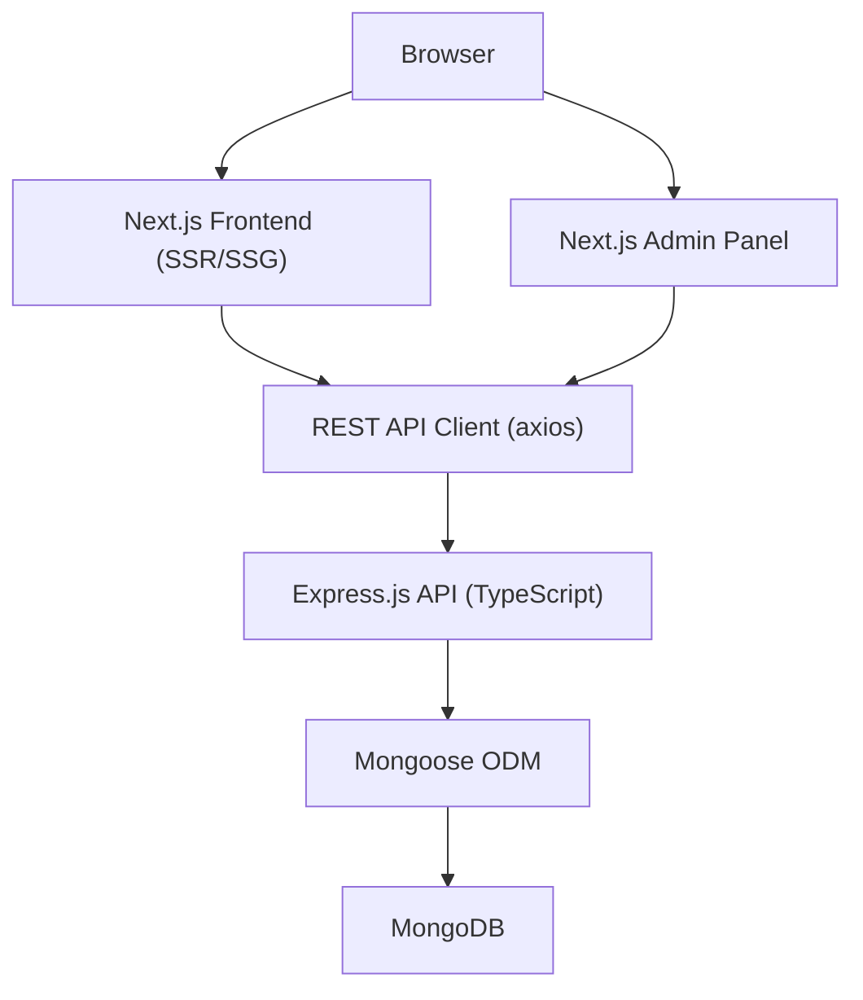

# Technical Architecture — My Web Helper

## 1. High-level Architecture


Monorepo layout (repo root = project folder, git remote preserved):
```
/
├── frontend/        # Next.js 14 App Router
├── backend/         # Express + TypeScript API
├── .trae/documents/ # PRD + architecture
├── README.md
└── .gitignore
```

## 2. Frontend Architecture
- **Framework**: Next.js 14 (App Router), React 18, TypeScript.
- **Styling**: Tailwind CSS with a custom design-token theme; CSS variables for brand colors.
- **Animation**: Framer Motion (entrance reveals, hover, stagger).
- **Icons**: lucide-react.
- **Forms**: react-hook-form + zod + @hookform/resolvers.
- **Data**: axios via `services/` layer; server components for SEO-critical reads with graceful fallback to static seed data when the API is offline.
- **Structure**:
```
frontend/src/
├── app/                # routes (public + admin)
├── components/         # ui/, layout/, home/, shared/
├── hooks/
├── lib/                # site config, utils, constants, seed content
├── services/           # api clients
├── types/
└── public/
```

### Routing map
| Route | Type | Notes |
|---|---|---|
| `/` | SSG | Homepage |
| `/about` | SSG | About Us |
| `/services` | SSG | Services index |
| `/services/[slug]` | SSG + generateStaticParams | Service detail |
| `/work` | SSG/ISR | Portfolio |
| `/case-studies` | SSG | Case studies |
| `/insights` | ISR | Blog index |
| `/insights/[slug]` | ISR | Blog detail + dynamic metadata |
| `/contact` | SSG | Contact + enquiry form |
| `/careers` | SSG | Careers |
| `/privacy-policy` | SSG | Legal |
| `/terms` | SSG | Legal |
| `/admin/login` | CSR | Admin login |
| `/admin` | CSR (protected) | Dashboard overview |
| `/admin/enquiries` | CSR | Manage enquiries |
| `/admin/blogs` | CSR | Manage blogs |
| `/admin/portfolio` | CSR | Manage portfolio |
| `/admin/testimonials` | CSR | Manage testimonials |
| `/admin/categories` | CSR | Manage categories |
| `sitemap.ts` / `robots.ts` | — | SEO |

## 3. Backend Architecture
- **Runtime**: Node.js + Express 4 + TypeScript.
- **DB**: MongoDB + Mongoose 8.
- **Security**: helmet, cors (allowlist), express-rate-limit, input validation (express-validator), bcryptjs, jsonwebtoken.
- **Docs**: swagger-ui-express + swagger-jsdoc at `/api-docs`.
- **Structure**:
```
backend/src/
├── config/       # env, db
├── controllers/
├── models/
├── routes/
├── middleware/   # auth, error, validate, notFound
├── services/
├── validators/
├── utils/        # ApiError, asyncHandler, token, logger
├── app.ts
└── server.ts
```

### API surface
| Method | Endpoint | Auth | Purpose |
|---|---|---|---|
| GET | `/api/health` | — | Health check |
| POST | `/api/auth/login` | — | Admin login → JWT |
| GET | `/api/auth/me` | ✔ | Current admin |
| POST | `/api/enquiries` | — | Create enquiry |
| GET | `/api/enquiries` | ✔ | List enquiries (filter by status) |
| PATCH | `/api/enquiries/:id/status` | ✔ | Update enquiry status |
| DELETE | `/api/enquiries/:id` | ✔ | Delete enquiry |
| GET | `/api/blogs` | — | Published blogs (query: category, search) |
| GET | `/api/blogs/:slug` | — | Blog by slug |
| GET | `/api/blogs/admin/all` | ✔ | All blogs |
| POST | `/api/blogs` | ✔ | Create |
| PUT | `/api/blogs/:id` | ✔ | Update |
| PATCH | `/api/blogs/:id/publish` | ✔ | Publish/unpublish |
| DELETE | `/api/blogs/:id` | ✔ | Delete |
| GET | `/api/portfolio` | — | List projects |
| POST | `/api/portfolio` | ✔ | Create |
| PUT | `/api/portfolio/:id` | ✔ | Update |
| DELETE | `/api/portfolio/:id` | ✔ | Delete |
| GET | `/api/testimonials` | — | List |
| POST | `/api/testimonials` | ✔ | Create |
| PUT | `/api/testimonials/:id` | ✔ | Update |
| DELETE | `/api/testimonials/:id` | ✔ | Delete |
| GET | `/api/categories` | — | List |
| POST/PUT/DELETE | `/api/categories` | ✔ | CRUD |
| GET | `/api/dashboard/stats` | ✔ | Stats + recent enquiries |

## 4. Data Models
- **Admin**: name, email (unique, indexed), password (hashed, select:false), role, timestamps.
- **ContactEnquiry**: name, email, company, phone, service, budget, message, status (new/read/in-progress/closed), timestamps; index on status + createdAt.
- **Category**: name, slug (unique), type (blog/portfolio), description.
- **Blog**: title, slug (unique), excerpt, content, coverImage, category (ref), tags, author, status (draft/published), publishedAt, seo{metaTitle,metaDescription,keywords}, readingTime, timestamps.
- **Portfolio**: title, slug (unique), client, summary, description, coverImage, images[], category (ref/string), technologies[], results[], featured, year, liveUrl, timestamps.
- **Testimonial**: name, role, company, avatar, quote, rating, featured, order.

## 5. Environment Variables
Frontend (`.env.local`): `NEXT_PUBLIC_API_URL`, `NEXT_PUBLIC_SITE_URL`.
Backend (`.env`): `NODE_ENV`, `PORT`, `MONGODB_URI`, `JWT_SECRET`, `JWT_EXPIRES_IN`, `CORS_ORIGINS`, `ADMIN_NAME`, `ADMIN_EMAIL`, `ADMIN_PASSWORD`, `RATE_LIMIT_WINDOW_MS`, `RATE_LIMIT_MAX`.

## 6. Resilience
Frontend content pages read from the API but fall back to curated seed data in `lib/seed` so the marketing site renders even when the backend is not running. Admin pages require a live API.

## 7. Quality Gates
- `npm run build` (frontend & backend) succeeds.
- `npm run lint` passes.
- API smoke tests via curl/Invoke-RestMethod.
- No secrets committed; `.env` gitignored.
